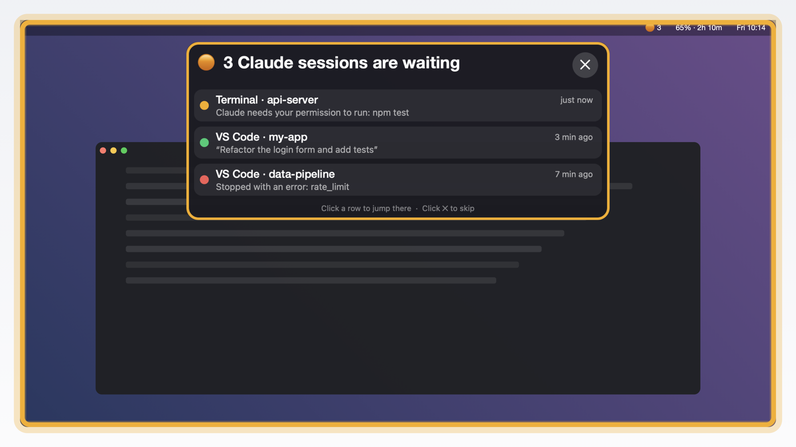
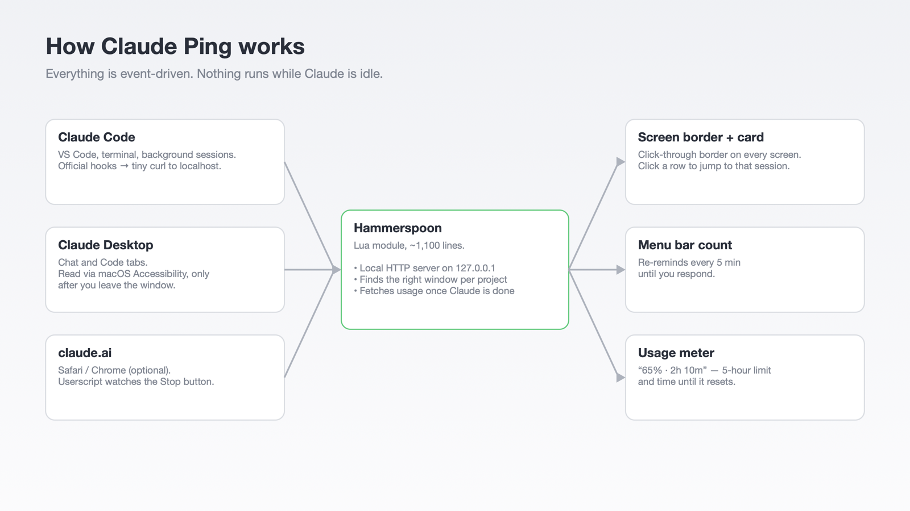
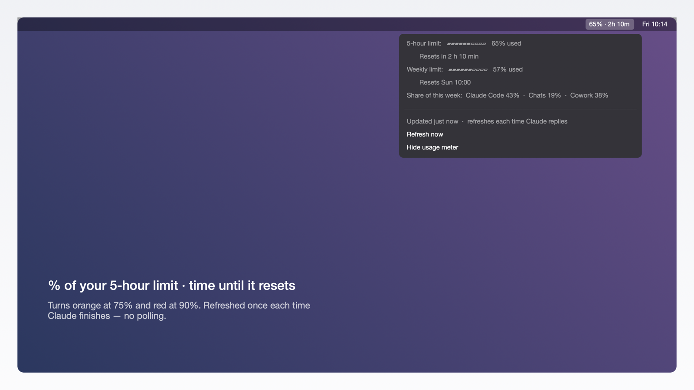

# Claude Ping

A big, hard-to-miss reminder on your Mac when Claude is done or needs you, plus a usage meter in the menu bar.



## What it is

You ask Claude something, switch to another window, and forget to come back. Claude Ping fixes that:

- **A thick colored border** appears around every screen. It is click-through, so it never blocks your work.
- **A card at the top** lists every Claude session that is waiting for you. Click a row to jump straight to that window. Click **✕** to skip.
- **A count in the menu bar.** It blinks and plays a sound again every 5 minutes until you respond.
- **A usage meter in the menu bar**, like `65% · 2h 10m`: how much of your 5-hour limit you have used, and how long until it resets.

The colors:

- 🟢 **Green**: Claude is done, your turn.
- 🟠 **Orange**: Claude asked a question or needs permission.
- 🔴 **Red**: the session stopped with an error.

If you are already looking at that window when Claude finishes, you only get a small toast.

## Works with

| Where you use Claude | How Claude Ping knows it is done |
|---|---|
| Claude Code in **VS Code** (extension or terminal) | Claude Code's official hooks |
| Claude Code in a **terminal**, including background `claude` sessions | Claude Code's official hooks |
| **Claude Desktop**, Chat and Code tabs | macOS Accessibility (reads the Stop / Send button) |
| **claude.ai** in Safari or Chrome | A small userscript (optional) |

## How it works



Claude Ping is a [Hammerspoon](https://www.hammerspoon.org) module written in Lua. Hammerspoon is a free, open-source macOS automation app.

1. **Claude Code** runs a tiny shell script through its [hooks](https://code.claude.com/docs/en/hooks) when a session stops, asks a question, or needs permission. The script sends one `curl` to a small HTTP server that Hammerspoon runs on `127.0.0.1`.
2. **Claude Desktop** has no hooks, and its Code tab runs sessions in a VM. So Claude Ping watches the window through macOS Accessibility, but only after you leave Claude Desktop and only while Claude is still answering. When the Stop button turns back into Send, Claude is done.
3. **claude.ai** in a browser uses an optional userscript that watches for the same Stop button.
4. To jump to the right place, Claude Ping matches the session's project folder against the window titles of VS Code, Cursor and common terminals, on any screen.
5. The **usage meter** is refreshed once, right after Claude finishes. It asks the same endpoint that Claude Code's `/usage` command uses.

Everything is event-driven. Nothing is polled while Claude is idle.

## Requirements

- macOS (tested on macOS 27.0.1)
- [Hammerspoon](https://www.hammerspoon.org) (the installer adds it with Homebrew if needed)
- [Claude Code](https://code.claude.com) for the hooks and the usage meter
- `jq`, which is built into macOS 15 and later

Tested with Hammerspoon 1.1.1, Claude Code 2.1.295, VS Code 1.136 and Claude Desktop 2.26454 / 2.31226.

## Install

1. Download the code:

   ```bash
   git clone https://github.com/Fitrim1411/claude-ping.git
   cd claude-ping
   ```

2. Run the installer:

   ```bash
   bash install.sh
   ```

   It will:
   - install Hammerspoon with Homebrew if it is missing;
   - copy the module to `~/.hammerspoon/` and load it from `init.lua`;
   - copy two small scripts to `~/.claude/hooks/`;
   - add hooks to `~/.claude/settings.json`. Your file is backed up first, and your other hooks stay untouched.

3. When Hammerspoon asks for **Accessibility** access, turn it on in System Settings. It is needed for Claude Desktop.

4. Open Hammerspoon's **Preferences** from its menu bar icon and check **Launch Hammerspoon at login**.

5. Click the **◌** icon in the menu bar and choose **Show a test reminder**. If a green border appears, you are done.

Claude Code picks up the new hooks on its own. If an already-open session doesn't react, restart it once.

The first time you jump to a Safari or Chrome tab, macOS asks if Hammerspoon may control the browser. Click **Allow**.

### Optional: Safari

1. Install the free **Userscripts** app (by Justin Wasack) from the App Store.
2. Open it and choose a folder for scripts.
3. Copy `claude-ping.user.js` into that folder.
4. In Safari, go to **Settings → Extensions**, turn on Userscripts, and allow it on `claude.ai`.

### Optional: Chrome

1. Install the **Tampermonkey** extension.
2. Go to `chrome://extensions`, open **Details** for Tampermonkey, and turn on **Allow User Scripts**.
3. In the Tampermonkey Dashboard, open **Utilities → Import from file** and pick `claude-ping.user.js`.

A claude.ai tab that finishes while you are not looking then shows a reminder and gets a ✅ in its title.

## Using it

| | |
|---|---|
| Click a row on the card | Jump to that session's window |
| Click **✕** | Skip all reminders |
| **⌃⌥⌘C** | Jump to the newest session |
| **⌃⌥⌘X** | Skip all reminders |
| **◌** menu | Waiting sessions, **Skip all**, **Show a test reminder**, **Do not disturb**, **Sound**, **Watch Claude Desktop**, **Usage meter in menu bar** |
| Usage meter menu | 5-hour and weekly limits, reset times, this week's split by app, **Refresh now** |

A reminder also goes away when you reply in that session or switch to its window.

### Settings

Open `~/.hammerspoon/claude_ping.lua` and edit the `M.config` block at the top: border width, card width, sound, reminder interval, shortcuts, and the usage meter's warning levels (orange at 75%, red at 90%). Then choose **Reload Config** from the Hammerspoon menu.



## Battery and privacy

- **Idle:** nothing runs. Hammerspoon sits at 0% CPU, waiting for a signal.
- **Claude Code hook:** one `curl` that lives for a fraction of a second. Background sessions add one `ps` call.
- **Border and card:** created when needed and removed when closed. The blink runs 8 times, then stops.
- **Claude Desktop:** checked every 2.5 s, only while Claude is answering and you are in another app. One check takes about 10–20 ms. It stops by itself when Claude is done.
- **Usage meter:** one small HTTPS request after Claude finishes, at most once a minute. A once-a-minute timer only updates the "time left" text.
- **Network:** the hook server only listens on `127.0.0.1` and ignores requests without a custom header, so web pages can't trigger it. The only request that leaves your Mac is the usage request to `api.anthropic.com`.

## ⚠️ Warnings

- **Unofficial.** Claude Ping is a personal project. It is not made by, endorsed by, or affiliated with Anthropic.
- **The usage meter reads your Claude Code login.** It takes Claude Code's OAuth token from the macOS Keychain and calls `api.anthropic.com/api/oauth/usage`, the same endpoint `/usage` uses. The token is never stored or sent anywhere else. This endpoint is not a public API and may change. If you don't want this, choose **Hide usage meter**; nothing is fetched while the meter is off.
- **Claude Desktop detection depends on its UI.** It looks for buttons named "Stop response" and "Send message" (English UI). A Claude Desktop update or another language can break it. See [Troubleshooting](#troubleshooting).
- **It edits `~/.claude/settings.json`.** A timestamped backup is made every time you install or uninstall.
- **Accessibility access** lets Hammerspoon read and control other apps. Only grant it if you are comfortable with that. Claude Ping only uses it to read Claude Desktop's buttons and to focus windows.
- **macOS only.**

## Troubleshooting

```bash
curl http://127.0.0.1:47823             # should print: claude-ping is running
hs -c "ClaudePing.test()"               # show a test reminder
hs -c "ClaudePing.debugDesktop(true)"   # list Claude Desktop's button labels in the Hammerspoon Console
~/.claude/hooks/claude-usage.sh --fetch # print the latest usage numbers as JSON
```

**Claude Desktop isn't detected.** Send a long message in Claude Desktop. While it is still answering, choose **Debug: check Claude Desktop buttons** from the ◌ menu. The Hammerspoon Console opens with a list of button labels. Add the stop button's label, in lowercase, to `stopLabels` in `M.config`, then reload.

**A click doesn't jump to the right window.** Every jump is logged in the Hammerspoon Console as `jump: <session> → <window>`. Claude Ping matches the session's project folder against window titles, so the window needs the project folder (or a subfolder) open.

## Uninstall

```bash
bash uninstall.sh
```

This removes the hooks (with a backup of `settings.json`), the scripts, and the module. Remove the userscript from Userscripts or Tampermonkey yourself.

## License

[MIT](LICENSE)
